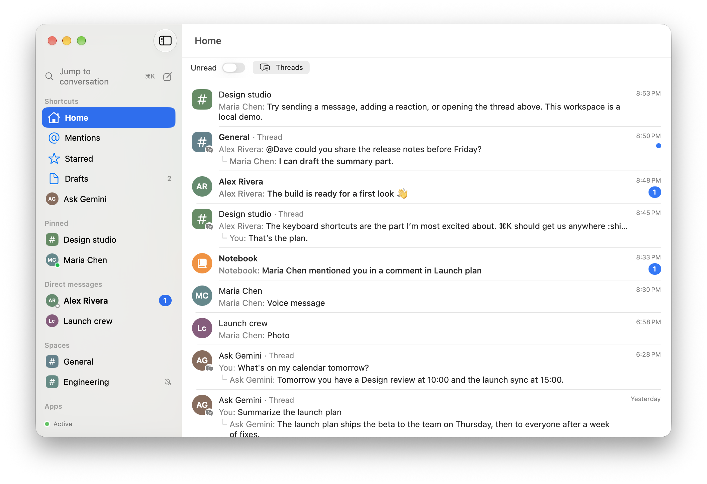
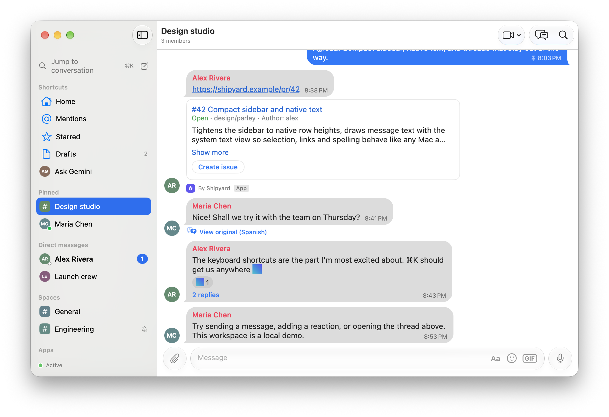
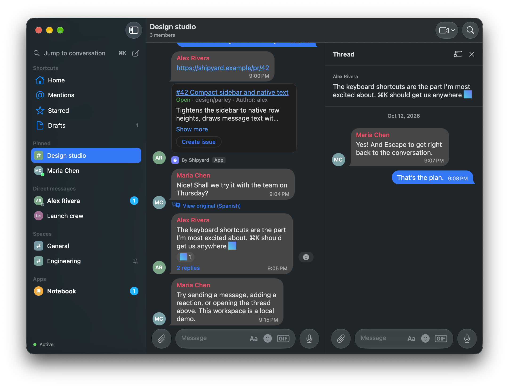
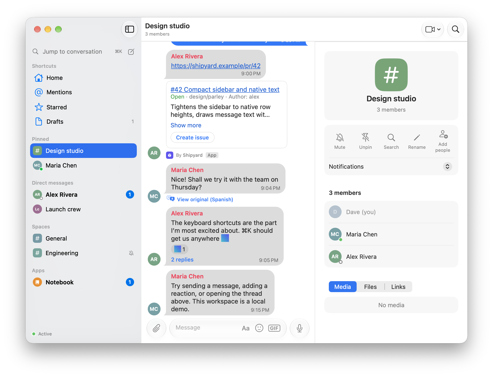
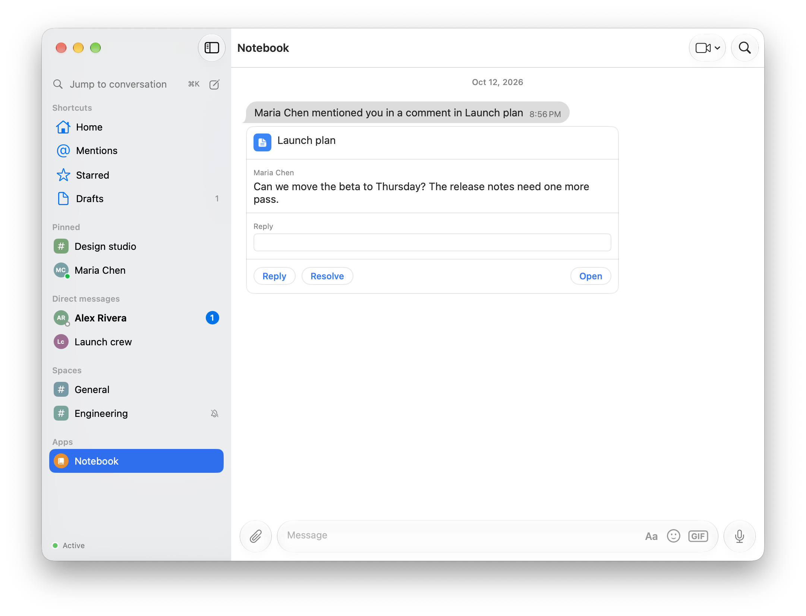

# Parley

A native macOS client for Google Chat, written in Swift with SwiftUI and AppKit.

Parley is an unofficial, independent project. It is not affiliated with or endorsed by Google. It uses the same private web API as Google Chat's web app, signed in with your own session. It stops working if Google changes that API. Use it with your own account.

An LLM wrote most of the code. It was tested it in daily use but didn't design or review it line by line. Expect rough edges, and read the code before relying on it.



| A conversation | Threads in a side pane, in dark mode |
|---|---|
|  |  |
| **The conversation info panel** | **An app's card, with Reply and Resolve in the card** |
|  |  |

## Why a Mac app

- **Notifications.** Native banners with a Reply field. Focus applies to them.
- **Dock.** An unread badge, and a Dock menu to open unread conversations or mark them all read.
- **Keyboard.** ⌘K opens any conversation, ⌘1 to ⌘9 the first nine, and ⌘F searches the open one.
- **Windows.** Any conversation or thread can open in its own window, and conversation windows join as tabs.
- **Shortcuts and Spotlight.** Shortcuts actions open, send and search, and Spotlight finds your conversations.
- **Sharing.** Parley is in the Share menu and in Services, for text, links and files.
- **Files.** Quick Look, and drag files in and out.
- **Handoff.** Continue the open conversation on your iPhone or iPad.
- **Links.** Google Chat links open in Parley when a link router such as [Velja](https://sindresorhus.com/velja) / [finicky](https://github.com/johnste/finicky) / [Choosy](https://choosy.app/) sends them there.

## Features

- **Sidebar.** Your Google Chat sections, pins, mutes and unread state, in sync with the web.
- **Timeline.** Bubbles or a plain list, with reactions, read receipts, previews and swipe to reply.
- **Threads.** A side pane, plus a list of a conversation's threads. Follow and read state sync.
- **Search.** Old results open among their neighbours, as on the web.
- **Composer.** Mentions, emoji, GIFs, slash commands, voice messages and full formatting.
- **Spaces.** Create spaces, accept invitations, and manage members, roles and settings.
- **Apps.** Chat app cards with working forms, buttons and polls.
- **More.** Meet links, translations, custom emoji, Ask Gemini, and block and report.

## Install

Download the latest DMG from [Releases](https://github.com/cuza/Parley/releases/latest) and drag Parley to Applications. Parley updates itself after that.

## Requirements

- macOS 15 or later
- Xcode 27 with Swift 6
- [XcodeGen](https://github.com/yonaskolb/XcodeGen) to generate the Xcode project from `project.yml`
- A Google account with Google Chat

## Building

1. Clone the repository.
2. In `project.yml`, set `DEVELOPMENT_TEAM` to your own Apple Developer team ID. It is the only place the team appears.
3. Generate the project and open it:
   ```sh
   xcodegen generate
   open Parley.xcodeproj
   ```
4. Build and run the `Parley` scheme.

Swift Package Manager resolves the dependencies, [SwiftProtobuf](https://github.com/apple/swift-protobuf) and [Sparkle](https://github.com/sparkle-project/Sparkle).

### Signing in

On first launch Parley shows a welcome screen. Sign in with Google opens a Google sign-in window inside Parley, with its own website data, separate from your browsers. Once Google has signed you in to Google Chat, Parley checks the session, keeps it in your Keychain and closes the window. Passkeys don't work in that window, so choose Try another way at that step.

Parley keeps your session only in the macOS Keychain. Signing out from Settings ▸ Account also clears the sign-in window's data.

### GIF search

Add your own GIPHY API key in Settings. Parley keeps it in the Keychain.

## Tests

```sh
xcodebuild test -project Parley.xcodeproj -scheme Parley -only-testing:ParleyTests -destination 'platform=macOS'
```

Unit tests use Swift Testing and run against a fake backend with stubbed network requests, so they never reach Google. UI tests (`ParleyUITests`) launch the app with the fake backend through launch arguments such as `-uiTestingLongHistory`, `-uiTestingManyConversations` and `-uiTestingFormattedThread`.

### Continuous integration

GitHub Actions runs `.github/workflows/ci.yml` on every push and pull request. It checks that the code is formatted, lints with SwiftLint (errors fail, warnings don't), generates the project and runs the unit tests without code signing. UI tests need a signed-in desktop session, so CI doesn't run them. The workflow uses GitHub's Xcode 27 runner image, which is still a preview, so treat its result as informational for now.

## Formatting and linting

[swift-format](https://github.com/swiftlang/swift-format), which comes with Xcode, formats the code: 4-space indentation and 120 columns, configured in `.swift-format`. [SwiftLint](https://github.com/realm/SwiftLint) then checks it with its default rules, configured in `.swiftlint.yml`, and leaves layout to the formatter. A pre-commit hook formats the Swift files each commit changes, then lints them. Lint errors stop the commit, and warnings are listed. A file with unstaged changes is checked instead of reformatted, so the commit never picks up unstaged edits. Turn the hook on once per clone:

```sh
brew install swiftlint
git config core.hooksPath .githooks
```

To format everything by hand, as CI checks it (protoc generates the files under `Proto/`, so they're left alone):

```sh
xcrun swift-format format -i --parallel $(git ls-files '*.swift' | grep -v '/Proto/')
```

Run `swiftlint` in the repository to lint everything.

## Architecture

Parley follows Clean Architecture in SwiftUI's own terms. Views read state from `@Observable` models and call actions on `ChatStore`. The store calls Google through the backend protocols in Domain, and Google's answers and pushed events come back as `ChatEvent`s, which the store routes to the model that owns them.

The code is in layers, and each layer only uses the ones inside it:

| Layer | Holds | Uses |
|---|---|---|
| `Domain` | Models, errors, the backend protocols | Foundation only |
| `Data` | The Google Chat client, Google's other services, sign-in, the launch cache | Domain |
| `Store` | `ChatStore` and the models it owns: presence, lookups, drafting, navigation, history, rooms | Domain |
| `Shared` | Views and helpers several features use | Domain |
| `Features` | One folder per feature: its views and its `ChatStore+<Feature>.swift` actions | Domain, Store, Shared, Intents |
| `App`, `Intents` | The entry point, menus, notifications, App Intents | Everything |

Domain and Data are modules of the local package `ParleyKit` (`ParleyDomain`, `ParleyData`), so the compiler enforces the rule for them: Domain can't see Data or the app, and Data sees only Domain. The other layers share the app target, where `ParleyTests/Architecture/DependencyRuleTests` checks the rule on every test run.

Two exceptions are deliberate. The sign-in feature works with the session directly, and the fake backend, in `Parley/Fake`, may use any layer.

A store model holds one area's state and the logic that needs nothing else. Actions that need the backend or several models are `ChatStore` extensions in the feature they serve. Switching accounts replaces the models.

To check that a refactor changes nothing, `ParleyTests/Regression/RegressionBaselineTests` records the demo workspace's screens, message layouts and a scripted session, then compares later runs. Record before the change, compare after, and run it on its own:

```sh
TEST_RUNNER_PARLEY_BASELINE=/path/to/baselines TEST_RUNNER_PARLEY_BASELINE_RECORD=1 xcodebuild test -project Parley.xcodeproj -scheme Parley -destination 'platform=macOS' -only-testing:ParleyTests/RegressionBaselineTests
TEST_RUNNER_PARLEY_BASELINE=/path/to/baselines xcodebuild test -project Parley.xcodeproj -scheme Parley -destination 'platform=macOS' -only-testing:ParleyTests/RegressionBaselineTests
```

## Project layout

| Path | Contents |
|---|---|
| `Parley/App` | App entry point, scenes, menu commands, notifications and Sparkle updates |
| `ParleyKit` | The local package with the inner layers as modules: `ParleyDomain` and `ParleyData` |
| `ParleyKit/Sources/ParleyDomain` | Models, errors and the backend protocols. Foundation only |
| `ParleyKit/Sources/ParleyData/Session` | Sign-in, the stored session and request signing |
| `ParleyKit/Sources/ParleyData/Dynamite` | The Google Chat client: backend, mapping, realtime channel and the generated protobuf code |
| `ParleyKit/Sources/ParleyData/Google` | Google's other services (Drive suggestions, People, Contacts) |
| `ParleyKit/Sources/ParleyData/Cache` | The launch cache |
| `Parley/Fake` | `FakeBackend`: the demo workspace and the tests' backend |
| `Parley/Store` | `ChatStore` and the models it owns (presence, lookups, drafts, navigation, history, conversations) |
| `Parley/Shared` | Views and helpers several features use |
| `Parley/Features/<Name>` | One folder per feature: its views and its `ChatStore+<Name>.swift` actions |
| `Parley/Intents` | App Intents for Shortcuts, Spotlight and Siri |
| `ParleyShare` | The Share menu extension |
| `Proto` | The protobuf schema; regenerate the Swift code with `protoc --proto_path=Proto --swift_out=ParleyKit/Sources/ParleyData/Dynamite/Proto Proto/dynamite.proto` |
| `ParleyTests`, `ParleyUITests` | Unit and UI tests; unit tests mirror `Parley/`'s folders |

## Acknowledgments

- [SwiftProtobuf](https://github.com/apple/swift-protobuf) (Apache License 2.0), the protobuf runtime and code generator.
- [XcodeGen](https://github.com/yonaskolb/XcodeGen) (MIT License), which generates the Xcode project.
- [Sparkle](https://github.com/sparkle-project/Sparkle) (MIT License), which updates the app.
- [purple-googlechat](https://github.com/EionRobb/purple-googlechat) (GPL-3.0) and [mautrix-googlechat](https://github.com/mautrix/googlechat) (AGPL-3.0), open-source Google Chat clients consulted as references for request and message formats.
- [Telegram for macOS](https://github.com/TelegramOrg/Telegram-macos-Swift), which inspired the timeline's design and swipe to reply.
- GIF search is [Powered by GIPHY](https://developers.giphy.com).

## License

Parley uses the MIT License. See [LICENSE](LICENSE).
